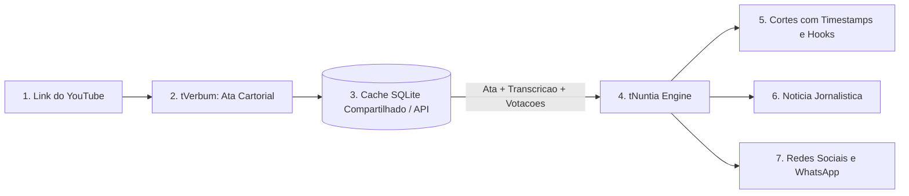

# 🎙️ tNuntia


> **Motor de Inteligência Artificial para geração de Cortes (Reels/Shorts/TikTok), Notícias Jornalísticas e Publicações para Redes Sociais a partir de vídeos de sessões legislativas da Câmara.**  
> Desenvolvido com integração nativa ao **[tVerbum](https://github.com/TTreter/tVerbum)** para economia de até 90% em tokens e custo zero de retrabalho.

O **tNuntia** (*do latim: anúncio, notícias, mensageiro*) foi projetado para transformar gravações longas de sessões plenárias e reuniões públicas (2 a 4 horas) em produtos de comunicação institucional prontos para publicação em portais de notícias, assessorias de imprensa e redes sociais.

---

## ✨ Principais Recursos

- **Motor Facilitador JSON (`Headless First`)**:
  - Retorna em uma única requisição a lista de cortes com timestamps, manchete e corpo da notícia jornalística e pacote completo para redes sociais.
- **Web Component Importável (`<tnuntia-studio>`)**:
  - Estúdio visual completo em formato de componente Web reutilizável encapsulado em *Shadow DOM* (`/tnuntia-studio.js`), que pode ser embutido em qualquer sistema web com 1 linha de código.
- **🎬 Seleção Inteligente de Cortes (Shorts / Reels / TikTok)**:
  - Identifica debates calorosos, discursos marcantes, votações decisivas e pronunciamentos comunitários.
  - Fornece **gancho de atenção inicial (`hook`)** para os primeiros 3 segundos, título provocativo e cálculo de minutagem ideal (30s a 90s).
  - Inclui índice de potencial viral e relevância pública (1 a 10) e links com salto temporal exato (`&t=X`).
- **📰 Notícias com Rigor Jornalístico (Portal da Câmara e Imprensa Local)**:
  - Estrutura completa de pirâmide invertida: Manchete (*Headline*), linha fina (*Deck*), *Lead* clássico, intertítulos, aspas de oradores e resumo das matérias votadas.
  - Quatro tons calibráveis: **Informativo** (oficial neutro), **Popular** (didático comunitário), **Institucional** (foco em governança) ou **Crítico** (destaque para cobranças e oposição).
- **📱 Pacote Estruturado para Múltiplas Redes**:
  - **Instagram / Facebook**: Legenda persuasiva com emojis e planejamento de **Carrossel (Cards 1 a 6)** com orientações visuais para o designer.
  - **X (antigo Twitter)**: Fio (*Thread*) cronológico de tweets curtos (até 270 caracteres).
  - **WhatsApp / Telegram**: Boletim formatado em negrito (`*`), tópicos e marcadores pronto para disparo a lideranças e grupos comunitários.
  - **LinkedIn**: Publicação com foco em governança pública, transparência e cidadania.
- **⚡ Integração em Cascata com o tVerbum**:
  - Reaproveita as transcrições, pautas e atas já processadas pelo **[tVerbum](https://github.com/TTreter/tVerbum)** via cache SQLite local ou API REST.
  - **Reduz em até 90% o consumo de tokens** e o tempo de processamento da IA, evitando reanalisar vídeos extensos.
  - **Modo Autônomo**: Se o tVerbum estiver offline, o tNuntia realiza a ingestão e extração de legendas diretamente do YouTube sem interrupção.
- **Player Sincronizado do YouTube**:
  - Dashboard integrado com player embutido: ao clicar em qualquer corte, o vídeo salta instantaneamente para a fala exata do vereador.
- **Exportação Multiformato**:
  - Exporta o dossiê completo de imprensa para **Word (.docx)**, **Markdown (.md)**, **HTML**, **JSON** e **Texto puro (.txt)**.

---

## 📐 Arquitetura de Integração e Economia de Tokens



### Comparativo de Consumo de Tokens

| Modo de Execução | Tokens Consumidos por Sessão | Latência Típica |
| :--- | :--- | :--- |
| **Isolado / Sem Integração** (Reingestão completa do vídeo de 3h) | 150.000 a 450.000 tokens | 60 a 120 segundos |
| **Integrado com tVerbum** (Reuso de ata + transcrição fatiada) | **8.000 a 25.000 tokens** *(~90% economia)* | **10 a 25 segundos** |

---

## 🚀 Instalação e Configuração

### 1. Clonar o repositório e instalar dependências
```bash
git clone https://github.com/TTreter/tNuntia.git
cd tNuntia
pip install -r requirements.txt
```

### 2. Configurar o `.env`
Copie o arquivo `.env.example` para `.env` e informe sua chave da API do Google Gemini:
```bash
cp .env.example .env
```
```env
GEMINI_API_KEY=sua_chave_aqui
DEFAULT_MODEL=gemini-3.8-flash
PORT=8001
TVERBUM_API_URL=http://localhost:8000
```

### 3. Iniciar o servidor
No Windows, basta dar dois cliques em **`iniciar_tnuntia.bat`** ou executar no terminal:
```bash
python run_server.py
```
*(Se desejar iniciar tanto o **tVerbum** quanto o **tNuntia** juntos, execute **`iniciar_ambos.bat`**).*

- **Interface Web de Estúdio**: `http://localhost:8001`
- **Documentação Interativa (Swagger)**: `http://localhost:8001/docs`

---

## 💻 Como Utilizar no Seu Sistema Web

### Opção 1: Consumir apenas o JSON (Headless Facilitador)
Ideal para portais de Câmaras, sistemas de assessoria ou dashboards administrativos:

```javascript
const response = await fetch('http://localhost:8001/api/generate', {
  method: 'POST',
  headers: { 'Content-Type': 'application/json' },
  body: JSON.stringify({
    video_url: 'https://www.youtube.com/watch?v=...',
    organization_name: 'Câmara Municipal de Exemplo',
    audience_tone: 'popular', // 'informativo', 'popular', 'institucional' ou 'critico'
    cuts_limit: 5,
    tverbum_session_id: 'latest' // 'latest' para puxar a última ata do tVerbum
  })
});

const data = await response.json();

// 1. Sugestões de cortes com timestamps exatos e gancho:
data.cuts.forEach(cut => {
  console.log(`[${cut.start_time} - ${cut.end_time}] ${cut.title}`);
  console.log(`Gancho (3s): "${cut.hook}" | Viral Score: ${cut.virality_score}/10`);
  console.log(`Link YouTube: ${cut.youtube_jump_url}`);
});

// 2. Notícia completa para o portal:
console.log(data.news.headline);
console.log(data.news.lead);
console.log(data.news.body);

// 3. Redes sociais:
console.log(data.social.instagram_caption);
console.log(data.social.whatsapp_bulletin);
console.log(data.social.twitter_thread);
```

---

### Opção 2: Importar o Web Component `<tnuntia-studio>` no seu Frontend
Para embutir o estúdio de comunicação em qualquer página HTML ou aplicação frontend com 1 linha de código:

```html
<!-- 1. Importe o script do componente -->
<script src="http://localhost:8001/tnuntia-studio.js"></script>

<!-- 2. Adicione a tag onde desejar na sua página -->
<tnuntia-studio api-base="http://localhost:8001"></tnuntia-studio>

<script>
  // Escuta o evento quando a geração for concluída:
  document.querySelector('tnuntia-studio').addEventListener('tnuntia-ready', (event) => {
    const dados = event.detail;
    console.log('Cortes e notícias gerados:', dados);
  });
</script>
```

---

### Opção 3: Uso Direto como Biblioteca Python
```python
from tnuntia import NuntiaConfig, NuntiaAIEngine, NuntiaExporter

config = NuntiaConfig(
    video_url="https://www.youtube.com/watch?v=...",
    organization_name="Câmara Municipal de Coronel Barros",
    audience_tone="informativo",
    cuts_limit=5,
)

engine = NuntiaAIEngine()
output = engine.generate(config)

print(output.news.headline)

# Exportar dossiê completo para Word (.docx) ou Markdown (.md)
NuntiaExporter.to_docx(output, "Dossie_Comunicacao.docx")
NuntiaExporter.to_markdown(output, "Dossie_Comunicacao.md")
```

---

### Opção 4: Linha de Comando (CLI)
```bash
# Processar sessão e salvar dossiês diretamente pelo terminal
python -m tnuntia "https://www.youtube.com/watch?v=..." --org "Câmara de Coronel Barros" --cuts 6 --export-md dossie.md --export-docx dossie.docx
```

---

## ⚙️ Parâmetros de Configuração (`NuntiaConfig`)

| Parâmetro | Tipo | Padrão | Descrição |
| :--- | :--- | :--- | :--- |
| `video_url` | `str` | *(obrigatório)* | URL do vídeo da sessão plenária no YouTube |
| `organization_name` | `str` | `""` | Nome da Câmara Municipal ou entidade pública |
| `session_number` | `str \| None` | `""` | Identificação formal da sessão ou ata (ex: `"21/2026"`) |
| `city_and_state` | `str` | `""` | Município e Estado para contextualização jornalística |
| `tverbum_session_id` | `str \| None` | `None` | UUID da ata gerada no tVerbum (ou `"latest"` para a última) |
| `tverbum_api_url` | `str \| None` | `None` | URL base do tVerbum (se não informada, lê de `TVERBUM_API_URL`) |
| `audience_tone` | `str` | `"informativo"` | Tom: `"informativo"`, `"popular"`, `"institucional"` ou `"critico"` |
| `cuts_limit` | `int` | `5` | Quantidade desejada de cortes sugeridos (`1` a `15`) |
| `agenda_context` | `str \| None` | `None` | Pauta oficial / Ordem do Dia para ancorar matérias |
| `custom_instructions`| `str \| None` | `None` | Diretrizes editoriais adicionais passadas pelo assessor |
| `model_name` | `str \| None` | `None` | Modelo específico do Gemini (ex: `"gemini-3.8-flash"`) |

---

## 🔌 Endpoints da API REST

| Método | Rota | Descrição |
| :--- | :--- | :--- |
| `GET` | `/` | Entrega o painel web de estúdio com player sincronizado |
| `GET` | `/tnuntia-studio.js` | Entrega o Web Component standalone `<tnuntia-studio>` |
| `GET` | `/api/health` | Diagnóstico de conexão com a API e cache do tVerbum |
| `GET` | `/api/tverbum/latest` | Puxa com 1 clique os dados da última ata gerada no tVerbum |
| `POST` | `/api/generate` | Processa a sessão e gera cortes, notícia e redes (`NuntiaOutput`) |
| `GET` | `/api/results/{id}` | Recupera uma sessão gerada anteriormente por ID |
| `GET` | `/api/results` | Lista todos os resultados gerados em memória |
| `POST` | `/api/export` | Exporta o resultado para `.docx`, `.md`, `.html`, `.json` ou `.txt` |
| `POST` | `/api/cut-video` | Executa o corte físico do vídeo via `yt-dlp` sem baixar o arquivo de 4h |

---

## 📄 Licença

Distribuído sob a licença [MIT](./LICENSE).
